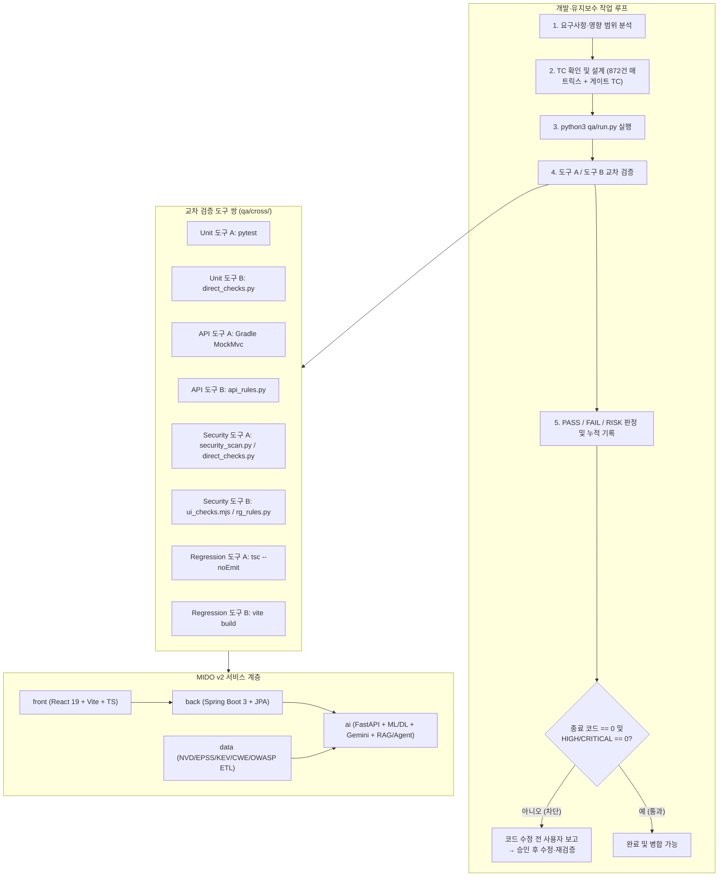

# MIDO v2 아키텍처 및 QA·Security 자동화 구조 (`ARCHITECTURE.md`)

## 1. 전체 시스템 및 QA 게이트 아키텍처

## 2. 핵심 구성 파일 및 역할

| 구분 | 경로 | 역할 |
| --- | --- | --- |
| 상시 강제 규칙 | `AGENTS.md` | 에이전트가 모든 작업 시 자동 실행할 최소 강제 규칙 |
| QA·보안 기준 정책 | `qa-policy.md` | 테스트 설계, 도구 쌍, 상태 판정, 기록 스키마, 완료/병합 차단 조건 정의 |
| 에이전트 스킬 | `.grok/skills/qa-security/SKILL.md`, `.agents/skills/qa-security/SKILL.md` | QA·Security 자동 실행 워크플로 지침 |
| 에이전트 훅 | `.grok/hooks/qa-gate.json`, `qa/hooks/stop_gate.py` | 제품 코드 변경 후 QA 미실행 시 종료 차단 |
| 통합 실행기 | `qa/run.py` | 도구 A/B 실행, 교차 판정, 리포트 생성, 종료 코드 반환 |
| 기록 생성기 | `qa/recorder.py` | `qa/reports/{test-type}/{YYYY-MM-DD}/` 하위 `pass.md`, `fail.md`, `risk.md`, `results.tsv` 누적 기록 |
| 교차 검증 도구 | `qa/cross/*.py`, `qa/cross/ui_checks.mjs` | 독립적인 두 번째 검증 도구 모음 |
| 전체 872건 매트릭스 | `qa/results/MD-01.tsv` ~ `MD-31.tsv` | 31개 QA 분야 872건 전체 테스트 케이스 실행·관찰 이력 |
| CI 게이트 | `.github/workflows/ci.yml` (`qa-gate` 잡) | GitHub Actions에서 `python3 qa/run.py` 실행 및 실패 시 빌드 차단 |
